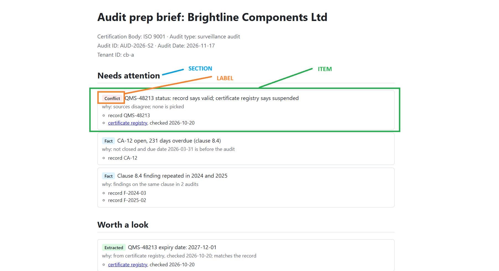

# Audit Brief - Prototype

Pre-audit preparation for certification auditors: flags what needs attention before an ISO 9001 surveillance audit, cites a source for every claim, and says when it doesn't know.

The rules surface what's already known from structured data, AI extracts what's in unstructured documents, and nothing reaches the auditor without a source it can be checked against.



## Quickstart

Installation:
```bash
uv sync --extra dev
```

Try it out:
```bash
# Brief for an auditee with rich history: generates out/brief.html + provenance.json, fully offline AI models
uv run audit-prep --client rich-history --out out/brief.html

# Same as above but a scenario when LLM is down: generates out/brief_no_llm.html + provenance.json
uv run audit-prep --client rich-history --no-llm  --out out/brief_no_llm.html
```

The first LLM run downloads Qwen2.5-3B (GGUF) from Hugging Face. Might take a minute or two extra.

## Docs

Order based on the parts in the technical challenge PDF.
| Part | Doc |
| --- | --- |
| 1. Frame the problem | [01-problem-framing.md](docs/01-problem-framing.md) |
| 2. Product experience | [02-product-experience.md](docs/02-product-experience.md) |
| 3. AI system design | [03-ai-system-design.md](docs/03-ai-system-design.md) |
| 4. Dealing with reality | [04-dealing-with-reality.md](docs/04-dealing-with-reality.md) |
| 5. Prove it works (incl. eval results) | [05-experiment-and-evaluation.md](docs/05-experiment-and-evaluation.md) |
| 6. Production | [06-production-and-ownership.md](docs/06-production-and-ownership.md) |

## What I built

- Synthetic data for two certification bodies (tenants) and two clients: structured records, documents, one scan, a mocked external registry, and an ISO 9001 scheme profile.
- A pipeline (not an agent): rules on records → OCR + keyword search → local LLM extracts claims from documents → citation and cross-source checks → rank and render an HTML **Audit Brief**.
- Every item carries one of six labels (``Fact``, ``Extracted``, ``Conflict``, ``Missing``). The LLM never picks the label. The documents in `docs/` also explain how we could use two additional labels - `Suggestion` and `Check source`

## What I'd do in the prototype with some more time

- **Reliable extraction:** small CPU models (1.5B / 3B) and keyword-only search are not reliable → try a bigger model and hybrid search (vector + keyword). The citation check only proves the quote is **on the page**, not that it **supports the claim** → add a verifier so a wrong claim can't reach the brief.
- **Entity linking:** the LLM can write the same id differently (`CA12` vs `CA-12`), so the claim skips the cross-source check and can hide a conflict → link every claim to a known entity first, unlinked ones go to **Missing**.

For detailed thigns which I feel would be good to have when moving towards production, see [06-production-and-ownership.md](docs/06-production-and-ownership.md).
