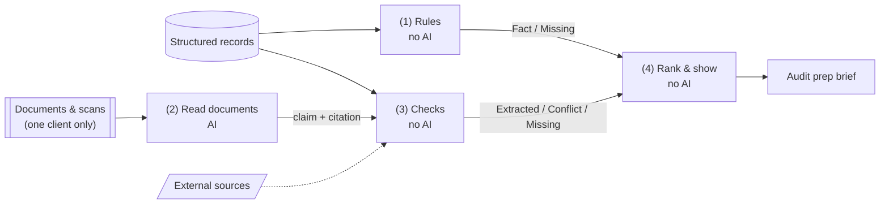
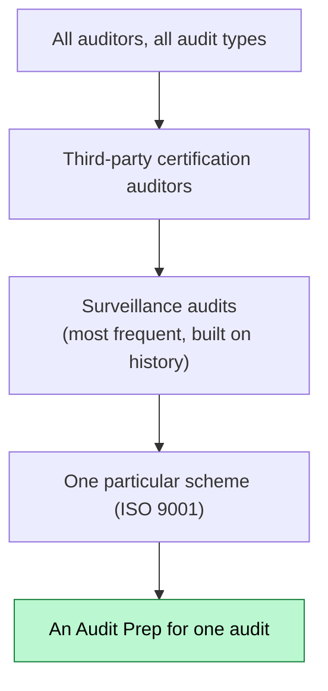

# 1. Framing the problem

> **TL;DR**
> - **Users:** auditors of every kind who must arrive at an audit knowing what deserves attention.
> - **Real problem:** not "summarise the client", but *where should I dig, and can I trust what the brief tells me?*
> - **Approach:** rules for the facts, AI only where text or images must be understood, and every item cites its source or says "I don't know".
> - **Smallest problem to attack first:** a third-party surveillance audit, see [section 6](#6-the-smallest-useful-slice).

---

## 1. Who the users are

Anyone who prepares for an audit faces the same question: *what deserves my attention, and why?* What differs is who they are and what kind of audit it is.

**By auditor type**

| Type | Who audits whom |
| --- | --- |
| **First party** (internal) | A company audits itself |
| **Second party** (supplier) | A customer audits its supplier |
| **Third party** (certification) | An independent certification body (CB) audits a client |

**By audit type** (certification cycle)

| Audit | What it asks | History available |
| --- | --- | --- |
| Initial | Does the system meet the standard? | None about the auditee |
| Surveillance | Is it still working? Were past findings fixed? | Yes, that's the core input |
| Recertification | Renew for another cycle? | Whole audit cycle |

The framing below holds for all of them. The choice of where to start is in [section 6](#6-the-smallest-useful-slice).

---

## 2. The problem I think we're solving

- **Finding information is only half of it. Trust is the open problem.** The auditor also needs to know where each point came from, what's missing and whether it's right.
- **The real decision is where to spend limited time**, not just what to read.
- **Missed issues are the big failure**, and they're invisible. A neat, confident brief can make the auditor over-rely on it and stop checking.

> **Problem statement:** help the auditor decide where to dig within the audit's scope, using a brief they can trust. Every item says *why* it's there, *where* it came from and *how sure* the system is, and the brief says plainly what it could not check.

"What deserves attention" is too vague to search for, so it becomes a fixed set of questions per audit type. This can be based on the feedback from real auditors on what they look for usually while doing the prep or if there's an audit plan provided by the Certification bodies. For eg. for a surveillance audit, these could be some of the questions important to answer to generate an audit prep document:
- Were last time's problems fixed?
- Is anything failing again?
- What changed since the last visit?
- Is anything expiring?
- What's missing?

---

## 3. What I'd want to learn first

| Question | Why it matters |
| --- | --- |
| Which **auditors and audit types** feel the most prep pain? | Decides where to start (see [section 6](#6-the-smallest-useful-slice)) |
| Which part of prep is slowest: **finding, reading or deciding**? | Reading → AI on documents. Deciding → via rules and layout (as much as possible). |
| Who writes the **audit plan**, and how much freedom is there? | Sets whether the brief says *what* or *where* to audit |
| What did auditors find on site that was **already visible in the records**? | These become the evaluation gold set |
| What do auditors **produce** from prep (notes, sampling plan)? | To understand how the output should look like for the auditors |
| How would they **check a claim**, and for how long? | Decides how citations must look |
| Where does client info **live** (only on Intact platform as structured data, or even on attachments, emails, PDFs which the client could load in the interface additionally)? | Structured vs unstructured data challenge |
| How different is data **across schemes**? | How far one design can stretch |
| How would the auditors prefer to interact with the assistant? | To decide if the interface needs to generate a one shot prep doc, or needs to be a chatbot or even a voice agent (or a mix of these)? |
| Which **external sources/APIs** do auditors check and how much do they **trust them**? | Helps in deciding how to show the data extracted from such sources. Is it reliable enough? |

---

## 4. Assumptions I'd challenge

| # | Assumption | My challenge | How to design accordingly |
| --- | --- | --- | --- |
| 1 | **Prep time is the cost to cut** *Brief: "Auditors spend significant time finding, reading and interpreting information before they can decide what actually deserves their attention."* | Faster prep doesn't necessarily solve the pain point | Measure missed issues and wrong claims, apart from the amount of time that it saves for the auditor |
| 2 | **Auditors will check what the AI says** *Brief: "what the system does, what the human does, and how uncertainty is handled"* | It's subjective and at times auditors may become over-reliant on the Audit Prep workflow and therefore may skip checking whether all relevant info is present | Always show "what I could **not** check" (eg: "*Certificate Scanning: unreadable, OCR confidence is low, so the expiry date of certification is unknown*")|
| 3 | **"I don't know" is always safe** *Brief: "An AI system that confidently invents something is therefore substantially worse than one that says it doesn't know."* | But too many abstentions could lead to auditors going back to Horizontal AI approach (like ChatGPT)[[1]](#ref-1) | Say "I don't know" only with a named reason (no data, quote not in source, unreadable scan). Otherwise show what *is* known and flag the gap, e.g. "CA-12 open in records; evidence data doesn't mention it". |
| 4 | **One design fits all audits and schemes** *Brief: "Help an auditor arrive at an audit knowing what deserves their attention and why."* | Auditor types, audit types, terms and versions differ[[2]](#ref-2); some clients have no history| Start narrow (section 6); use thin/small history as a test case |

---

## 5. Where AI helps, and where it doesn't

The questions from section 2 go through **four layers**. AI works in only one of them, and code checks everything it produces.

| Layer | AI? | What it does | Label |
| --- | --- | --- | --- |
| (1) **Rules** | ❌ | Answers the questions from the records: overdue CAs, repeat findings, expiries, scope changes, missing documents | **Fact** / **Missing** |
| (2) **Read documents** | ✅ | Searches one client's documents for evidence on the same questions (RAG); returns claims with citations. Also reads scans (OCR) | candidate claim |
| (3) **Checks** | ❌ | **Citation check:** is the cited text really in the source? If not, hide it. **Record check:** does the claim agree with the records? If not, flag it. | **Extracted** / **Conflict** / **Missing** |
| (4) **Rank & show** | ❌ | Orders items with a fixed scoring rule (conflicts first, then overdue CAs, …) and adds rule-based suggestions | keeps label + citation; **Suggestion** |

- **Why two checks?** The citation check proves *the document says it*; the record check proves *it matches the CB's records*.
- **Never AI:** like data access control (which client, which certificaiton body).

| Choice | Preferred approach | Not preferred |
| --- | --- | --- |
| Where questions come from | Fixed list, written with auditors | LLM invents questions: can silently skip the hard ones. (TODO: can we use it based on a fusion like approach?)|
| How records are asked | Rules and exact queries | Text-to-SQL: can be silently wrong |
| How documents are asked | Targeted search driven by the records | "Summarise this client": this is too generic and minor but improtant gaps might go unnoticed |

**Later:** clause tagging and entity matching for messy legacy data, a knowledge graph with GraphRAG for multi-hop/follow-up questions, cross-scheme term mapping[[2]](#ref-2).

## 6. Smallest useful experiment

### Narrowing down

### The slice

> **For one ISO 9001 surveillance audit, produce a one-page attention brief:** open and repeating issues from the records, what submitted documents say about them, where the two disagree, and what could not be checked. Every item has a source and a label: **Fact · Extracted · Suggestion · Conflict · Missing**.

| ✅ In scope | ❌ Out of scope |
| --- | --- |
| One scheme (ISO 9001), one audit type | Other auditor and audit types (for now) |
| Rules on records + AI on a few documents and one scan | Scheduling auditors, writing reports |
| A client with rich history and one with almost none | Chat interface |
| A document that contradicts the records | Multiple schemes |
| An evaluation set with planted issues | Training any model |
| A fake external source | Live external APIs which auditors use |

**Why this slice:**
- **Rules alone are useful on day one** and give the AI a baseline to beat.
- **AI only where needed**, so its errors are easy to isolate.
- **Measurable before customers see it:** issues caught, claims wrong, unneeded abstentions.
- **Hard/edge cases:** thin history, conflicting sources, unreadable scan.
- **Generalize:** the same rules, labels and verifier apply to other audit types; only the rule set changes.

---

## Sources

1. Intact whitepaper *When Auditors Use AI* (2026), §2.1 "Shadow AI".
2. Intact whitepaper *Horizontal vs Vertical AI*, §2: "Each scheme has its own logic" and "Version history matters".

