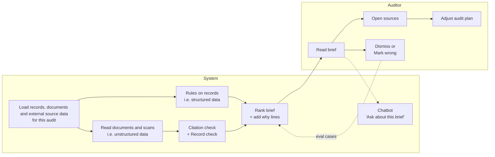
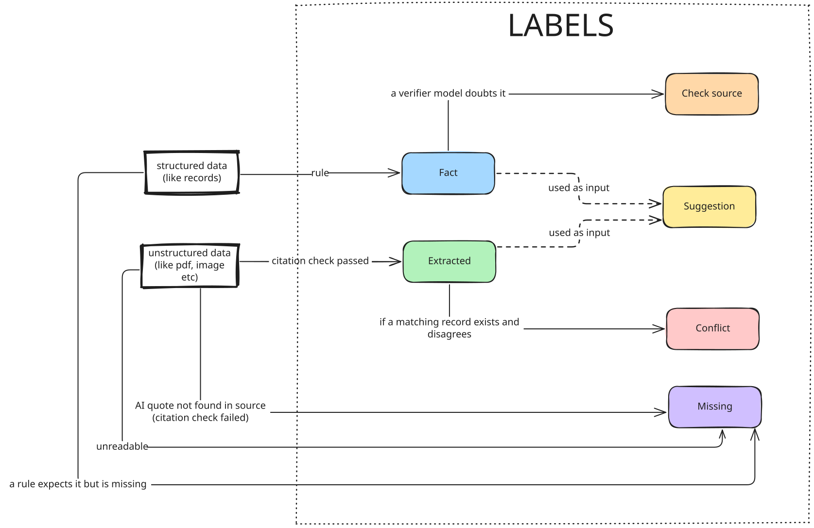
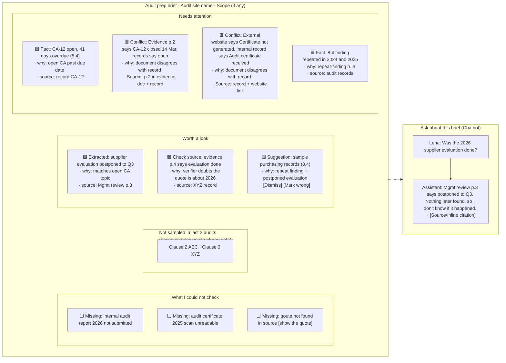

# 2. Product experience

> **TL;DR**
> - The auditor gets a one-page brief which is ranked by the priority/attention it needs, where every item has a reason to why its there, a source from where it comes from and a label. Follow up questions from the auditor goes to an **'Ask about this brief'** chat assistant
> - We label every item in the brief (eg. is it a **FACT**, or a **SUGGESTION**) instead of showing any confidence score/percentage.
> - It also contains a section called **'What I could not check'** to show missing information in the brief.
> - The auditor makes the decision based on the brief, the system only flags but never performs a tie-breaker in case of any conflict in the data sources.
> - The document below explains the full experience but the prototype will only cover preparing the brief and not the chat assistant.

---

## A storyboard
This walkthrough explains what the system does vs what the auditor does through an example:

1. Suppose an auditor (say 'Lena') needs to make a visit to an auditee next week.
2. She logs in to INTACT platform and clicks on 'Audit Prep' tab. She is asked to select an auditee from a list of assigned auditees to her. 
3. The system generates a 'Audit Brief' (lets call it 'brief' in the document below). This brief is a static HTML like page with options to click on links. And an option to export the brief as PDF.
2. At the top of the brief, Lena sees 'Needs Attention' section which contains some conflicts.
    - 2.1. Lena clicks the conflict item --> sees the link to both the source documents where the conflict arose.
    - 2.2. She clicks on the link and jumps to the page or record using the link to skim over whats there.
    - 2.3. She makes a note to check about this during the audit (**TODO**: can this also be a part of the product? add a notes/todo service linked to the system?)
3. Lena then moves on to the next section 'Worth a look'.
    - 3.1 She checks the sources but needs some more info on it.
    - 3.2 Lena asks a follow up question in the chat assistant.
    - 3.3 Chat assistant answers back with citations.
    - 3.4 Lena feels its not correct (eg. she opens the cited page and the quote doesnt support the answer)
    - 3.5 She opens the brief again and clicks a buton beside that item as 'Mark wrong' (thought: this single click serves 2 benefits: adds an eval case for the system and also turns the item to some other color so that Lena is aware about it)
4. Lena then looks at another item in the 'Worth a look' section, and marks it as 'Dismiss' with a reason 'e.g., already checked over the phone call'. This item is then greyed out with the note.
5. Lena then checks the 'What I could not check' section.
    - 5.1 A document was missing in the database, so she emails the auditee to send it before the visit.
    - 5.2 A PDF was unreadable by the system (eg. low OCR condifence), so she adds "check calibration certificate on site" to her notes.
6. She adjusts her audit plan based on the brief she read.

---

## Who does what

---

## How we use 'Labels' in the brief

No confidence % anywhere as the model scores aren't reliable percentages. 
The label tells the auditor what kind of evidence an item rests on, so that the auditor can judge herself.

The flow above is more of a refined version of whats presented in [01-problem-framing.md, section 5](01-problem-framing.md#5-where-ai-helps-and-where-it-doesnt).

| Label | Meaning | Example |
| --- | --- | --- |
| **Fact** | Computed by a rule from records, so its a fact. (Not based on unstructured data or external data as it could be unreliable) | X is open, 10 days overdue |
| **Extracted** | Read from a document (unstructured data) and its quote can be found in the source via citation. Or data extracted from external sources. | Mgmt review p.3: "supplier evaluation postponed to Q3" |
| **Check source** | Quote is real, but a second check doubts that it supports the claim | Evidence p.4 quoted as "evaluation done", but the sentence is about 2023 |
| **Suggestion** | A hint built from items above. Not a fact. | Consider sampling purchasing records (8.4) |
| **Conflict** | Two sources disagree. Both are shown but none picked | Records: X is open, Evidence: "X was closed in 2025" |
| **Missing** | Required data is absent or unreadable | Certificate PDF was unreadable |

## How the product experience looks like

How the auditor interacts:

- Reads it top to bottom
- Clicks an item -> its source opens (the record or the document at the cited page)
- Acts on items: Dismiss (with a reason), Mark wrong, Add to plan
- Asks the chat

### Input from Auditor's side
|Input | Used for|
| --- | --- |
|Which audit she’s preparing | What to build the brief for (defines the scope to fetch the records/docs as well)|
|Dismiss + reason |	Hides noise |
|Mark wrong |	Eval cases|
|Add to plan / notes | Her audit plan|
|Chat questions | |

### Example of a Brief
---

In the whole product experience, whenever something is AI generated show some visible marker mentioned 'AI Generated'.

### Which section an item goes to
| Section	| Which label goes here	| Why| 
| --- | --- | --- | 
| Needs attention	| Conflicts, Facts	| Critical as they could change the audit plan and the auditor needs to act on it | 
| Worth a look	| Extracted, Check source, Suggestions	| Useful context, but not proven or not urgent| 
| Not sampled in last 2 audits | (Clauses in scope but not covered recently i.e. clauses in this audit’s scope − clauses covered in the last 2 audits = not sampled)	| so the auditor doesn’t only follow history | 
| What I could not check | Missing	| Gaps are never mixed with findings | 

Fixed rules, no AI, so the same data always gives the same order.

---

## When the AI is wrong

The prototype must show each of these.

| What goes wrong | What the auditor sees |
| --- | --- |
| Model invents a quote | Label: Missing (can be mapped to a separate one) and maybe with an option to see what AI quoted |
| Document contradicts the records | Label: Conflict, Why: (some reason), Source: (some source) |
| Scan is unreadable | Label: Missing, Why: XYZ Doc unreadable |
| New client with almost no history | Label: Missing, Why: "Not enough history to assess" |
| AI misreads a real quote and makes a wrong claim and all checks pass (e.g. verifier is off or misses it) | Label: Extracted, but the exact quote is shown right next to the claim, so the auditor can spot the mismatch. She clicks 'Mark wrong' → item is marked and becomes an eval case
| A record itself is wrong | Label: Fact, Source: record link. Nothing can catch it unless another soruce contradicts (then its assigned Conflict Label). The auditor can still click 'Mark Wrong'|

The checks reduce mistakes but can't remove them. That's why every item keeps its source next to it, and the brief never shows a claim the auditor can't check herself.