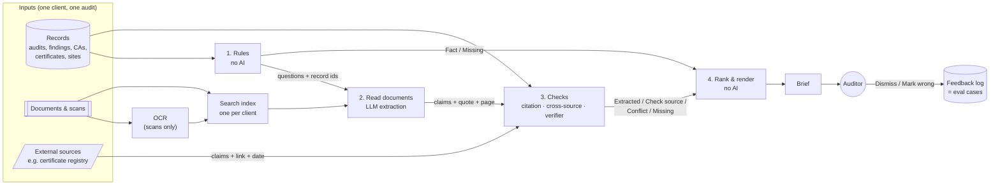

# 3. AI system design

> **TL;DR**
> - A pipeline, not an agent: rules on applied on records, one LLM step to read documents, then code that checks everything the LLM says.
> - All three data types (records, documents and scans, external sources) end up as claims in **one shape**, so one set of checks covers them all.
> - The LLM is used only where text or scans must be understood. Checks, labels, ranking, wording and access are deterministic.
> - Anything the system can't verify is shown as Missing with a reason, never guessed.
> - Chatbot has been excluded for creating the prototype for now and it only includes preparing a Audit Brief.

---

## Architecture

Every claim, whatever its source, has the same shape: **thing · id · field · value · source**. See ``Key Decisions`` (Point #2) section for more details.

---

## Components

| Component | What it does | How | Why it's there |
| --- | --- | --- | --- |
| Data loader | Fetches records, documents and external data for one audit and scoped to one client | Code | Scoping happens first so no other client's data can reach the LLM or accessed by the Auditor |
| Rules | Answers fixed questions from records | Code | Exact and cheap |
| OCR | Turns image scans into text, with a confidence per text scanned | Traditional ML for OCR | Some evidence exists only as images. If low confidence → attached to **'Missing'** label in the brief |
| Search index | Finds passages in this client's documents for each question based on a hand crafted list of questions | Embeddings with Hybrid retrieval (vector search + keyword) | Gives good recall by extracting everything relevant and narrows down what the LLM reads |
| Extraction | Reads the retrieved passages and returns claims in the fixed shape, with quote and page | LLM with structured output | The only step in prototype that needs language understanding |
| External lookup | Queries a short list of trusted public sources using some filters (eg. client name) | Code (API calls) + entity matching | Sometimes risks only show up outside the client's own data |
| Citation check | Is the quote really on the cited page? | Code (fuzzy string match) | Catches quotes 'invented' by AI. On failure → attached to **'Missing'** label in the brief |
| Cross-source check | Groups claims about the same thing and field. If values differ → attached to **'Conflict'** label | Code | One generic comparison for any pair: record, document, external |
| Verifier (optional) | Does the quote actually support the claim? | Small classifier (eg. Jev style) | Catches real but misread quotes. If doubtful (low confidence) → attached to **'Check source'** label |
| Ranking | Orders items with a fixed scoring rule.| Code | Readable, tunable, the same every run so that the next time auditor opens a new brief, they experience a simialr structured brief (consistency in output structure) |
| Renderer (eg. HTML page) | Builds the brief from sentence templates, with labels, why lines and source links | Code | Wording can't hallucinate. |
| Auditor Feedback | Stores **'Dismiss'** / **'Mark wrong'** with reasons | Code | Helps in building an eval set. Not used for training |
| Chat (not in prototype, but would good to have later) | Answers follow ups from the same index, with the same checks | LLM + same checks | Optional as an add-on to the Audit Brief doc |

---

## Key decisions

1. **Questions drive retrieval.** The system searches for evidence on the fixed questions, not "summarise this client".
2. **Every source gets converted to the same small row:** Each row has: `thing`, `id`, ``field``, ``value``, ``source``.

``
From records: CA | CA-12 | status | open | record
``

``
From a document: CA | CA-12 | status | closed | doc p.4
``

``
From the external source: certificate | C-881 | expiry | 2026-03 | registry
``

Note: the field names above are fixed. We provide a list of allowed fields which comes from a defined set. Set once for all clients and audits (if possible).

3. **No source is assumed right:** Records, documents and external data can all disagree with each other, even two records. Any disagreement is a **'Conflict'** label in the Audit Brief showing every source. The auditor decides.
4. **LLM never decides the label:** Labels come from which checks pass, not from the model.
5. **Templates and not generated text:** All brief wording comes from templates. The only LLM written text is an extracted claim, always shown next to its exact quote.
6. **External data is evidence, never a 'Fact':** It carries its source and the date it was checked. Can't rely on external data to keep it as a **'Fact'**
7. **When unsure, say so:** Anything unverifiable is attached to **'Missing'** label with its reason. The brief can be incomplete but shouldnt be confidently wrong.
8. **Model-agnostic:** LLM sits behind one interface. The prototype replays saved responses, so it runs offline and tests are repeatable.

---

## Rejected alternatives

| Alternatives considered | Why rejected for now |
| --- | --- |
| One LLM call that writes the whole brief | Auditors might not rely on a full summary generated without any clear labels or the soruce where it comers from. Also, its difficult to verify which sentence came from where and hallucinations look like facts. We can keep a short summary at the end of the brief based on the whole brief tempalte shown in  |
| Agent that decides what to look for | Coverage becomes unpredictable, hard to evaluate and can silently skip hard questions. |
| Text-to-SQL on SQL records | Can be wrong as it needs AI (MCP servers also exist which makes the performance better but still not completely reliable). If we have an audit plan on what things to check on for the meeting prep, the questions are fixed, so plain queries are enough |
| Treating records as the truth | Records can be wrong too. So in case of any conflict with any other source document, AI shall not pick a side. |
| LLM confidence % on items | Confidence scores are 'generative' by LLM, brings false precision. Jev like models might be useful but still doesnt give a good UX to the user. |
| Fine-tuning a model | Training on customer data might be a problem. Prompting + checks is enough for initial version |
| Knowledge graph / GraphRAG for prototype | Useful for follow-ups later specially when user wants to use a chatbot and wants to ask a multi-hop query or about a general theme which a single chunk cannot answer. Not necessary for a one-page brief in initial version|

---

## Prototype vs production

| Part | Prototype | Production |
| --- | --- | --- |
| Records | Synthetically designed JSON | Intact database or platform API |
| Documents | A few PDFs and one scan of an image | Document storage |
| External | One fake registry file consisting of one entry which disagrees with the records leading to a  **'Conflict'** | Only allow list of trusted sources |
| LLM | Replayed saved responses (no API key) | Hosted model |
| Search | Simple keyword search | Hybrid search with indexing based on aprticular client being audited for data privacy and avoids accessing data outside the permissions granted |
| Verifier | Not built (described) | Can be added if evaluation shows it helps |
| Output | Static HTML file | Page in the platform with actions (**Dismiss**/**Mark wrong** as described in ) |

