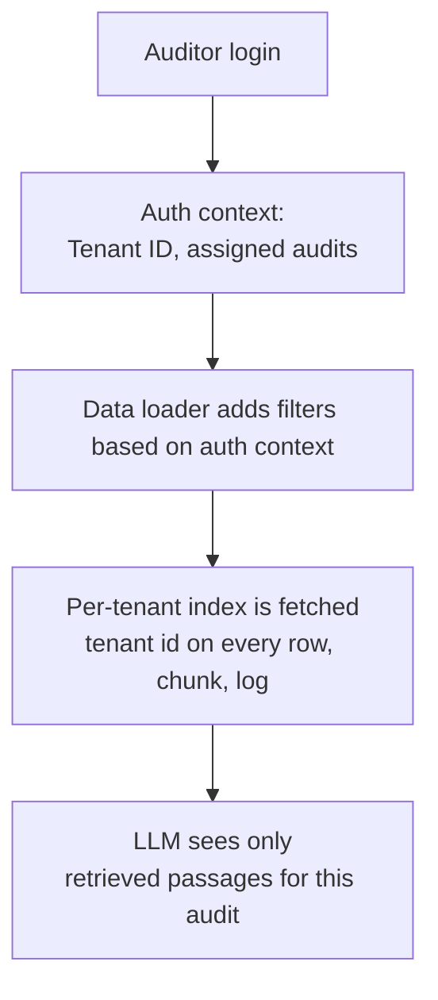

# 4. How to deal with uncomfortable realities

## What changes w.r.t. part 3 (system design)

Same diagram as part 3; green boxes are new.

```mermaid
flowchart LR
    AUTH["NEW: Auditor login<br/>· assigned audits"] -->|"audit filter applied"| LOAD["NEW: Data loader<br/>no AI Agents involved"]
    LOAD --> IN

    subgraph IN["Inputs (one client, one audit)"]
        REC[("Records<br/>audits, findings, CAs,<br/>certificates, sites")]
        QL["Question list<br/>per audit type"]
        DOC[["Documents & scans"]]
        EXT[/"External sources<br/>e.g. certificate registry"/]
    end

    PROF["NEW: Scheme profile<br/>terms · clauses · versions"] -->|"questions for this scheme"| QL
    PROF -->|"term map"| RULES

    REC -->|"records"| DQ["NEW: Data quality check"]
    DQ -->|"records + gaps flagged"| RULES["Step 1: Rules<br/>no AI"]
    DOC -->|"image pages"| OCR["Step 2a: OCR<br/>traditional ML"]
    DOC -->|"text pages"| IDX["Step 2b: Search index<br/>one per client"]
    OCR -->|"text + word confidence"| IDX

    RULES -->|"what to look for<br/>e.g. CA-12"| READ["Step 3: Read documents<br/>LLM extraction"]
    QL -->|"standing questions<br/>e.g. changes since last visit"| READ
    IDX -->|"matching passages"| READ

    READ -->|"claims + quote + page"| CHK["Step 4: Checks<br/>citation · cross-source · verifier"]
    EXT -->|"claims + link + date"| CHK
    REC -->|"record values"| CHK

    RULES -->|"Fact / Missing"| RANK["Step 5: Rank & render<br/>no AI"]
    CHK -->|"Extracted / Check source /<br/>Conflict / Missing"| RANK

    RANK -->|"ordered items<br/>in templates"| BRIEF["Brief"]
    RANK -->|"sources · versions · model"| PROV[("NEW: Provenance log")]
    BRIEF --> AUD((Auditor))
    AUD -->|"Dismiss / Mark wrong"| LOG[("Feedback log<br/>= eval cases")]

    classDef new fill:#dcfce7,stroke:#15803d,stroke-width:2px,color:#000
    class AUTH,LOAD,PROF,DQ,PROV new
```

---

## How to deal with uncomfortable realities

| # | Reality | What breaks if ignored | Design change | What the auditor sees |
| --- | --- | --- | --- | --- |
| 1 | Historical data quality varies substantially between customers | Rules applied on records show a success for something while the cell is actually empty | Data quality check on data loading (empty fields, bad dates, duplicates). A rule that needs a missing field returns **Missing** label in the brief | Affected items as Missing with reason |
| 2 | Terminology differs between certification schemes | Same thing but with different names. Questions and field map don't fit | Create a **Scheme profile** as config: term map, clause list + version, question set per audit type. When there's a new mapping: LLM proposes, human approves | Same labels and layout for every scheme |
| 3 | Info only in PDFs, scans, images | Key evidence will become invisible | Page triage (text vs image) → OCR with per-word confidence. if there's low confidence on the cited words → assign **Missing** label in the brief to that item. (Can use optional vision model for photos/tables with same checks) | "Scan unreadable" in *What I could not check* |
| 4 | Some customers have little history | Rules return nothing | Fall back to **scheme-level questions** (requirements, not history).| Shorter brief with a clear "new client: history-based checks skipped" note |
| 5 | Customers must not see each other's data | Leads to lack of trust | See [Tenant isolation & authorization](#tenant-isolation--authorization) | - |
| 6 | Auditors need to know where claims came from | Lack of trust as auditor cant verify the findins in the brief | See [Provenance](#provenance) | Every item clickable to its exact source |
| 7 | AI conclusions can't be assumed correct | Hallucinated or misread claims look like facts | Already in part 3 (checks, labels, templates) + **prompt injection** guard (see [Hallucination](#hallucination-and-untrusted-input)) | Every AI item shows its label and exact quote, so it never looks like a Fact. Invented quotes appear as Missing, doubtful ones as Check source. The auditor can click Mark wrong on any item. |
| 8 | Some customers prohibit training on their data | GDPR concerns | See [No-training customers](#privacy-and-no-training-customers) | - |

---

## Tenant isolation & authorization

Two levels: the **tenant** (an Intact customer, eg. a Certification Body) and the **client** being audited inside it. Plus the **auditor's** own rights.

**TODO:** Do auditors also have defined roles? Can we use that as well for authorization context to restrict the permissions to view specific docs?

- Assumption is that Tenant id on every record, document, chunk and log line
- Separate index (or namespace) per tenant, no shared vector store without a hard filter
- LLM has **no tools** to get data itself, so it can't access the database directly
- Prompts and examples contain **synthetic** data only, never another customer's
- Prompt injection attacks are mitigated by clear sectioning in the prompt on where the system instructions are vs the placeholder is. Additionally when a placeholder is replaced with actual data, a small classifier check can be done to see if the data which replaces the placeholder contains any potential attack to the system. --> this is jsut a thought not in prototype.

---

## Provenance

- How to cite items in the **'Audit Brief'**:

| Source | What to keep in citation |
| --- | --- |
| Record (structured) | record ID + record version |
| Document (unstructured) | doc ID + doc version + page + quote |
| Image (unstructured) | doc ID + doc version + page + (optional) a cropped snapshot |
| External | link |

- Every run keeps: rule version, prompt version, model version, time
- Since the records could change after the brief: store the **version of all cited docs/records used to build the brief**

---

## Hallucination and untrusted input

| Risk | Guard | Deterministic? |
| --- | --- | --- |
| Invented quote by AI from unstructured doc | If citation check fails → **'Missing'** label assigned to the item in brief | Yes |
| Real quote but wrong meaning | Jev like Verifier → **'Check source'** label assigned to the item in brief | separate AI classifier, to be checked by eval set|
| Wrong value / disagreement | Cross-source check → **'Conflict'** label assigned to the item in brief | Yes |
| Made-up wording in the brief | Use templates only for phrasing anything in the brief (as much as possible) | Yes |
| **Instructions hidden in an uploaded document** for prompt injection attach | Document text treated as data, fixed structured output from LLM, any claim still needs a matching quote via citation check | Prompt injection can be fully prevented. But there are ways to prevent the auditor to blindly rely on it because (1) data extracted from uploaded docuemnts (unstructured data) are never assigned as **Facts**, instead assigned as **Extracted**. (2) in case it contradicts with any record (structured data), its assigned as **Conflict** |
| Model says "I'm sure" | Never used as we map every item in the brief with a label (Fact, Extracted, Conflict etc) | Yes |

---

## Privacy and no-training customers

- Design uses **prompting + retrieval + checks**, no fine-tuning/training in the first version/prototype
- LLM provider with no training on input data, Hosted LLM region chosen based on customer (e.g. EU-north, US-east etc)
- Per-tenant data usage agreement: should the auditor's feedback on the items listed in the Audit Brief (via **'Mark wrong'** action button beside each item) be used beyond this tenant's own eval? We can set this to NO by default.
- Eval data: synthetic + tenants who opted in to use their data for eval
- Option for strict tenants: local SLM/LLM behind the same model-agnostic interface

---

## Data quality

| Check on data loading time | If it fails |
| --- | --- |
| Required field empty | Assign **Missing** label with reason |
| Date impossible or in wrong format | Assign **Missing** label with reason |
| Duplicate records | Apply some merge rule, if they disagree then **Conflict** label assigned |
| Record points to something missing | Assign **Missing** label with reason |
| Document can't be parsed due to low OCR conf. | Assign **Missing** label with reason |

Optionally, we can track the number of low data quality cases over the run and use it to improve the database.

---

## Graceful degradation

The brief never fails as a whole. If anything fails, that particular piece is dropped out with a reason wherever possible.

| What fails | How to handle |
| --- | --- |
| LLM unavailable | Rules-only brief + a section with "documents not read" |
| External source's service is down | a section with "external sources not read" |
| OCR low confidence | That item assigned to **Missing** label |
| Little or no history | Scheme-level questions + "not enough history" |
| Poor data quality | Item assigned to **Missing** label |
| Verifier (Jev) unavailable | Extracted items shown without the extra check with some mark on it |

---

## Evaluation

- Red teaming: Synthetic eval set with **planted issues** (eg. conflict, invented quote, unreadable scan, no history, injected instruction for attacks, cross-tenant data leakage)
- Metrics: planted issues caught, wrong claims shown as Fact/Extracted, data leaks (must be 0)
- Regression tests: We run these tests on every prompt, model or rule change
- In production: Wehn auditors click on action buttons beside the items in the brief (**Mark wrong** and **Dismiss**), we feed these items as new eval cases

---

## Kept deterministic, constrained or verifiable

| Part | Mode | Why |
| --- | --- | --- |
| Access, tenant and audit scoping | Deterministic | Can't be probabilistic |
| Rules on records (dates, counts, repeats) | Deterministic | Exact answers exist |
| Field mapping, scheme terms | Config (can be generated by LLM but human approved) | Same input → same output |
| Labels | Deterministic (from checks) | Model can't grade itself, leads to hallucinations |
| Ranking and wording | Deterministic | Consistent, testable, no invented text |
| Extraction from documents | **Constrained** LLM: fixed schema, fixed fields, only retrieved passages, must quote | Needs language understanding |
| Every item with **Extracted** label | **Independently verified**: citation check, cross-source, verifier | Trust comes from checks, not the model |
| OCR | ML with its own confidence | Its errors are visible and measurable |

---

