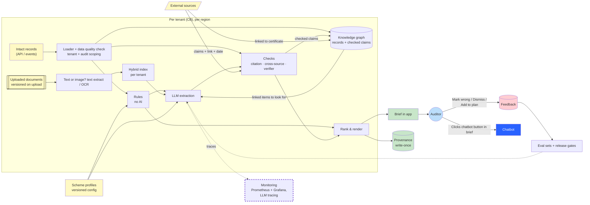
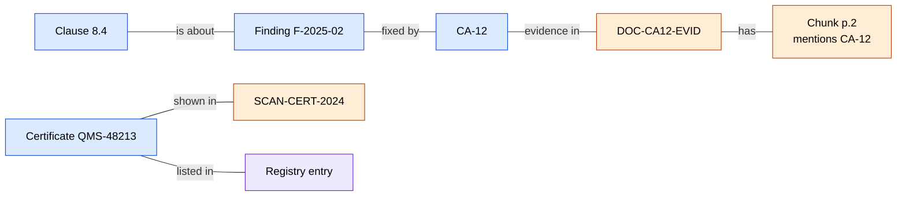

# 6. Production and ownership

---

## 1. Prototype to production

| Area | Prototype | Production |
| --- | --- | --- |
| Data in | Synthetic files per client folder | Intact platform records via APIs/events + uploaded documents, tenant id on everything |
| Documents | Text files + PNG scans | PDFs, Office files, scans, photos|
| OCR | RapidOCR, local | Picked by eval on real scans (RapidOCR / cloud OCR / vision model for photos and tables) |
| Search | Keyword index per client | Hybrid (keyword + multilingual vector search) + following graph links, one index/namespace per tenant |
| Knowledge graph | Links only inside the records | Graph of records + checked claims, per tenant (see [Knowledge graph and GraphRAG](#knowledge-graph-and-graphrag)) |
| LLM | Qwen2.5 3B/1.5B| Hosted model per region, or local for strict tenants; same `LLM` interface, picked by eval |
| Verifier | Not built | Natural Language Classifier models (e.g. non autoregressive decision models like [Laya](https://huggingface.co/convaiinnovations/laya) based on [Jev](https://typesafe.ai/blog/introducing-system-one-models-and-jev) or LLM encoders like DeBERTa) → **Check source** label addition in the brief |
| Scheme profile | One JSON file | Versioned config per scheme + audit type, LLM proposes, human approves |
| Run | CLI | Batch job nightly for next week's audits + on-demand refresh |
| Output | Static HTML | In-app brief with **Mark wrong / Dismiss / Add to plan** + (option to export brief as PDF) |
| Chatbot | Not built | An action button in the **Audit Brief** page which lets Auditors ask about some more info from the data and gets back grounded responses with inline citation. GraphRAG fits here for open questions |
| Provenance | JSON + sha256 of inputs | Version ids at upload, write-once storage (see [section 4](#4-provenance-and-records)) |
| Eval | Script on synthetic gold set | CI gate on every change + per-tenant dashboards from feedback |

---

## 2. Across customers, countries and schemes

**Customers (tenants)**

- Tenant id on every record, chunk. Scoping happens in the loader before any search (as in [04](04-dealing-with-reality.md#tenant-isolation--authorization)).
- Data leak test runs in CI and as a periodic check in production.
- Per-tenant settings: model location (hosted vs local), feedback use (own eval only by default).

**Countries**

- Choose appropriate model based on customers region.
- Languages: multilingual embeddings + multilingual LLM OR specific embedding/LLM based on customer from specific country. Claims keep the fixed shape; quotes stay in the original language so the citation check still works.

**Schemes**

- New scheme = new scheme profile (terms, clauses + version, question set per audit type), not new code.
- LLM proposes the mapping from the standard text, a scheme expert approves it, it's saved as a config.
- Each new scheme gets its own slice in the gold set.

---

## 3. Risks, trade-offs and controls

| Risk | Control | Metric / alarm |
| --- | --- | --- |
| Wrong item shown as Fact / Extracted | Checks decide labels, verifier, templates only, release gate = 0 on gold set | Mark wrong rate per label |
| Cross-tenant leak | Scoping in loader, per-tenant index, no tools for the LLM, leak test in CI | Leaks = 0, alarm on any |
| Auditor over-relies on the brief | "What I could not check" always shown, labels, no confidence %, sources one click away | Share of items with source opened; nothing marked wrong for weeks is a warning too |
| Too many Missing / Check source → brief ignored | Tune OCR/verifier thresholds on eval (calibration), better retrieval | Missing and Check source rate per tenant, alarm on jumps |
| Model / provider change breaks quality | Same eval on every change, pin model + prompt versions | Eval diff in CI |
| Prompt injection via uploaded docs | Document text is data, tuned prompt isolating system instruction with injected data, fixed output schema, citation + cross-source checks, (optional) classifier to detect malicious data | Planted #12 in gold set |
| Cost and latency at scale | Model cascade (small first, bigger only when verifier doubts), nightly precompute, skip LLM when search finds nothing | Cost and time per brief |
| Wrong links in the graph (e.g. two different sites merged) | Only checked claims and human-approved merges go into the graph | Merge errors found by auditors via **'Mark wrong'** |

**Trade-offs**

- Recall vs trust: rather miss an item (shown as Missing or not shown) than show a wrong one as Extracted.
- If any info is unable to reach upto the final output for any reason (e.g., LLM down), show the remaining info which coudl reach and add a banner about what failed during the processing (eg. could't retrieve unstrcutured data as AI service is down)
- Fixed templates over nicer wording: its less natural but at least nothing is 'generated' by LLM. Optionally, if still want to avoid template based workings in the final Brief, we can use LLM with additional eval metrics on the text generated like Faithfulness/Correctness/Appropriateness etc.

---

## 4. Provenance and records

CBs must keep audit records, so a brief and what it was built from may be asked for later.

| Need | Prototype | Production |
| --- | --- | --- |
| Which exact document | sha256 at save time | Blob versioning (S3 / Azure Blob): version id per upload |
| Which exact records | — | Table versions (Temporal tables via SQL db or Deltalake depending on infra) |
| Can't be changed later | — | Write-once storage (S3 Object Lock / Azure immutable blob) |
| Which model / prompt / profile | Versions in provenance JSON | Prompt + model registry (MLFLow), LLM tracing (Langfuse) |

---

## 5. Operating practices

- **Release:** change → eval in CI → offline run on recent audits → canary rollout on a few tenants → everyone. Rollback = previous prompt/model version.
- **Monitoring:** Missing / Check source / Conflict rates, Mark wrong rate, leak check, latency, cost, model errors. Per tenant and per scheme. Tools: **Prometheus** for fetching metrics, **Grafana** dashboards for monitoring per tenant and scheme with alerts. LLM calls traced via Langfuse.
- **Feedback loop:** every Mark wrong → triaged (my side) → becomes an eval case → fix → gate. Weekly review of the top issues.
- **Incident:** a wrong item reported → find the brief's provenance → which step failed (sent / claim / check) → add as eval case → fix.
- **Degradation:** LLM, OCR or external source down → that part dropped with a banner, rest of the brief still built (refer to [04](04-dealing-with-reality.md#graceful-degradation)).

---

## 6. Where ML takes over as it scales

| What | Type |
| --- | --- |
| **Verifier** as non autoregressive decision model (System One) → for **Check source** label in the Brief | System One Frontier Model, CPU |
| **Clause tagging:** old findings are often plain text with no clause number (e.g. "supplier not re-evaluated"). A model adds the clause (8.4), so the repeat-finding and not-sampled rules also work on old data | LLM / embedding classifier |
| **Entity matching** ("ACME Berlin plant" = site BER-01), dedup records | Classical ML, LLM for hard cases |
| **Threshold calibration** for OCR and verifier from the eval set | Small classic ML model (logistic regression) on the eval set |
| **Learning to rank** from Dismiss / Add to plan; rule order stays as baseline | Ranking model learned based on auditor clicks on the action buttons in the Brief (eg. LightGBM which runs on CPU) |
| Small fine-tuned models for unstructured data extraction after chunks retrieved | Only tenants who allow training on their data|
| **Recommendations** from similar audits → Suggestion (see [below](#recommendations-from-many-audits)) | Counts first, then a recommender |

### Knowledge graph and GraphRAG

**What it is:** dots and relationships. Many relationships already exist as ids in the records, the graph also links documents, chunks and external sources to them.

Blue = structured (records) · Orange = unstructured (documents, chunks, scans) · Purple = external source (registry)

**Where it helps**

| Where | How | Example |
| --- | --- | --- |
| Linking sources | Records, documents, scans and registry meet on one dot | QMS-48213 → its scan and registry entry, even when the scan text is smudged (#8 in [05](05-experiment-and-evaluation.md)) |
| Hybrid search during unstrcutured data's retrieval| Narrows *where* to search: chunks linked to the item first, all chunks as fallback | CA-12 → chunks of DOC-CA12-EVID; nothing found → search all of the client's chunks |
| Many small chunks | Each chunk links to its page and to the ids it mentions; neighbours linked too | "Chunks mentioning CA-12" is an exact lookup; send the chunk + neighbours so the LLM keeps context |
| Long chains | A single query instead of many joins | Clause 8.4 → finding → CA → supplier → same supplier's findings at other sites |
| Same thing, two names | Merge into one dot (human-approved) | "ACME Berlin plant" = site BER-01 |
| Across schemes | Clause mapping as lines | ISO 9001 8.4 ↔ matching IFS clause |

**Where it doesn't help**

- Simple record rules (overdue CA, repeat finding): (SQL can do this)
- Extraction: the LLM still reads the text. The graph only picks what it reads.
- Labels and wording: still rules, checks and templates.

**How a result is made:** follow the lines → a rule decides the label → a template writes the line. E.g. QMS-48213 → record says *valid*, registry says *suspended* → two values for one field → **Conflict**.

**GraphRAG (eg. Microsoft GraphRAG):** the LLM builds the graph and summaries itself. Will be good for Chatbot where Auditors might have open chat questions ("what keeps coming up over 5 years?"), not for the Audit Brief doc.

### Recommendations from many audits

Once there are many audits, patterns across similar clients can point the auditor to clauses worth checking. This should be shown as **Suggestion**, never as Fact.

| Idea | What the auditor sees | How |
| --- | --- | --- |
| Similar clients | "Consider sampling 8.4: 30% of 40 similar audits (same industry, size, scheme) had findings there" | Counts per clause per industry first; later a client × clause recommender |
| Thin-history clients | Suggested clauses from similar clients, so the brief isn't almost empty | Same as above. Helps most here |
| Order of items | Most useful items first | Learning to rank from **Add to plan / Dismiss** |

Note: We use this recommendation engine only if the suggestions catch more actual findings compred to without providing the suggestion baseline version. We can evaluate this by testing the recommndation engine on past audit's data it hasn't seen before. (provided we have the rights to use that data)

---

## 7. What I'd own as the Applied AI/ML Engineer

- Extraction from unstrcutured data pipeline: retreiver based on keyword and vector indexing, SLM/LLM benchmarking
- Checks on Extracted data: citation and quote checks
- Verfied model: System one decision models benchmarking
- OCR
- Entity matching and search that follows graph links
- Smaller ML models (see [section 6](#6-where-ml-takes-over-as-it-scales)): clause tagging, threshold calibration, learning to rank
- Recommendations from similar audits: building them and testing them on past audits before integrating in the solution.
- Fine-tuned extraction model, only for tenants that allow training on their data
- Chatbot assistant
- Evaluation set creation, regression based CI gates
- Monitoring and traceability of the AI steps
- Scheme profile tooling on the AI side (LLM proposes mappings)

## 8. What I'd expect from the others

| Team | What I'd need |
| --- | --- |
| **Product** | Which audits/schemes first, KPIs, access to auditors and a CB, the call on brief only vs brief + chat assistant |
| **Design** | How labels, Missing and "what I could not check" read for auditors; feedback buttons that people actually click; test for over-reliance based on number of clicks made to citations |
| **Data Engineering** | Graph store and its schema, records + document versions per tenant, data snapshots for replay, data quality reports|
| **Engineering** | Auth and tenant scoping, the service and batch jobs, storage, monitoring/tracing infra |
| **Auditors / scheme experts** | Labelling the gold set (maybe based on LLM generated set), approving scheme profiles |

